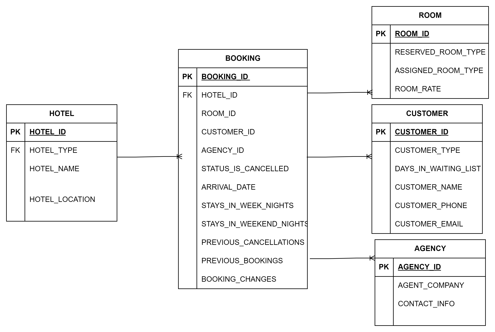

<div align="center">

# Hotel Management System (SQL)

**A relational database for hotel reservations, guests, rooms, billing, and analytics**


</div>

---

## Overview

Many hotels still run on outdated technology, manual workflows, and scattered data. This project designs a **Hotel Management System (HMS) database** that brings the core hotel operations into one relational model:

| Module | Purpose |
|:--|:--|
| **Reservation Management** | Streamline bookings, modifications, and cancellations, and optimize room availability |
| **Guest Management** | Store guest profiles, preferences, and feedback for personalized service |
| **Room Management** | Track room inventory, rates, and real-time status for smooth check-ins and check-outs |
| **Billing & Payments** | Automate invoicing and payment records to reduce errors |
| **Inventory Management** | Monitor supply levels to prevent stockouts and overstocking |
| **Reporting & Analytics** | Report on occupancy, revenue, and guest demographics to support decisions |

## Entity-Relationship Design



**Conceptual model:** `HOTEL`, `BOOKING`, `ROOM`, `CUSTOMER`, `AGENCY`. A booking links a hotel, a room, a customer, and an optional travel agency, and records arrival dates, stay length, cancellations, and booking changes.

## Implementation (MySQL)

The working implementation in [`sql/`](sql) builds the operational core of the system:

| Script | What it does |
|:--|:--|
| [`01_schema.sql`](sql/01_schema.sql) | Creates the `HotelManagement` database and the `guests`, `rooms`, `reservations`, and `payments` tables with primary and foreign keys |
| [`02_sample_data.sql`](sql/02_sample_data.sql) | Loads sample guests, rooms, reservations, and payments, then verifies them |
| [`03_stored_procedures.sql`](sql/03_stored_procedures.sql) | `GetReservations(RoomID)`: a stored procedure that returns all reservations for a room |
| [`04_bulk_import_clients.sql`](sql/04_bulk_import_clients.sql) | Bulk-loads client records from a CSV file with `LOAD DATA INFILE` |

### Run it

```bash
mysql -u root -p < sql/01_schema.sql
mysql -u root -p < sql/02_sample_data.sql
mysql -u root -p < sql/03_stored_procedures.sql
# Optional: update the CSV path in 04 first
mysql -u root -p < sql/04_bulk_import_clients.sql
```

Example output of `CALL GetReservations(1);`

| id | guest_id | room_id | check_in_date | check_out_date | payment_status |
|--:|--:|--:|:--|:--|:--|
| 1 | 1 | 1 | 2023-05-10 14:00:00 | 2023-05-12 11:00:00 | Paid |

## Database Design Objectives

- **Data integrity:** Primary keys, foreign keys, and validation rules prevent duplicate records and keep references consistent.
- **Normalization:** The schema minimizes redundancy and avoids insert, update, and delete anomalies.
- **Scalability:** The structure supports new facilities, services, or locations without major redesign.
- **Performance:** Indexing and query optimization keep frequent lookups fast.
- **Security:** Role-based access protects guest and payment data.
- **Reporting:** The schema is designed for occupancy, revenue, and guest analytics.

## Business Impact

Automating reservations, room management, and billing reduces manual work and errors. Guest preference data supports personalized service and loyalty, and real-time occupancy data supports pricing and revenue decisions.

## Repository Contents

```
hotel-management-system-sql/
├── README.md
├── sql/
│   ├── 01_schema.sql
│   ├── 02_sample_data.sql
│   ├── 03_stored_procedures.sql
│   └── 04_bulk_import_clients.sql
└── docs/
    ├── ER_Diagram.png
    └── Hotel_Management_System_Report.pdf
```

## Team

Clark University, M.S. Business Analytics (May 2024). Group 6: Vaibhavi Shastri, Muskaan Nayan Jain, **Deepthi Sri Kunapareddi**, Mythri Sreepada, Shruthi Salla.
